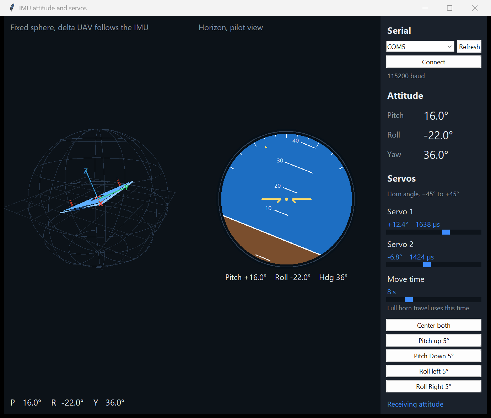
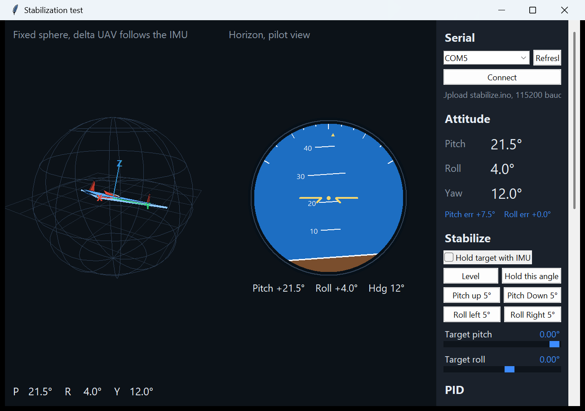
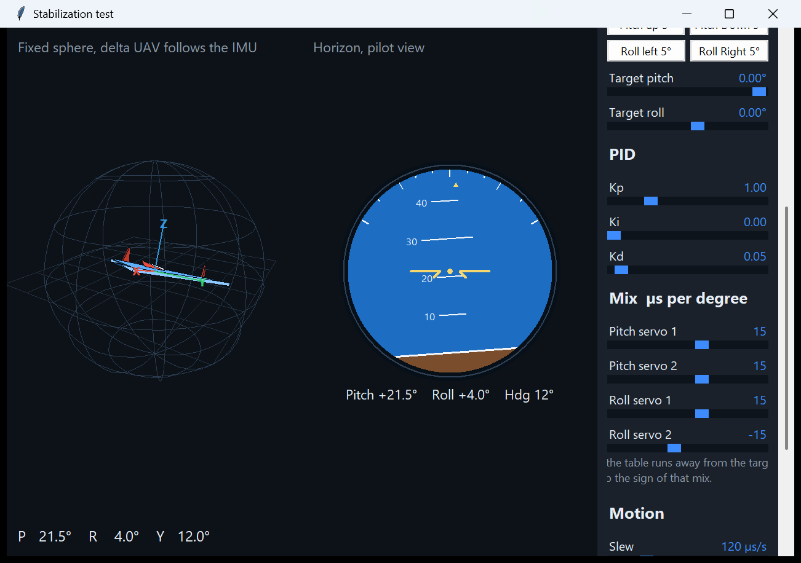
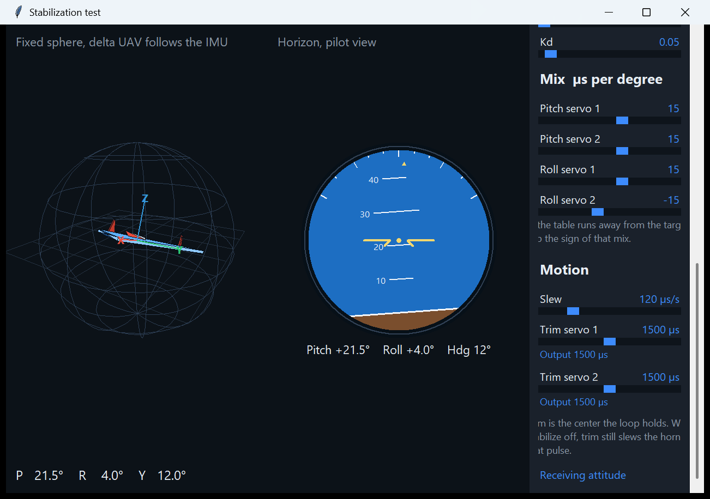

<p align="center">
  
</p>

<h1 align="center">Two-axis IMU turntable</h1>

<p align="center">
  An Arduino Mega reads an MPU9250, draws the attitude live, and drives two high-torque servos on a worm-gear turntable.<br>
  One window commands the horns. A second window holds pitch and roll with a PID loop.
</p>

The table is a heavy pan-tilt gimbal. Each axis is a READYTOSKY TD8135MG servo coupled into an NMRV050 worm gearbox. The Mega runs FreeRTOS: one task fuses the IMU, one task reads serial commands, and the horns move on a slew so the gearbox is not stepped.

---

## What you can do

| | |
|---|---|
| **Watch the platform** | A wireframe sphere carries a delta aircraft. Beside it, a pilot horizon banks and pitches with the same angles. |
| **Command the horns** | Sliders run from −45° to +45° at the servo horn. Move time is how long a full sweep takes. |
| **Recall a 5° pose** | Pitch up, pitch down, roll left, and roll right finish on measured pulse pairs. |
| **Hold an IMU angle** | The stabilization sketch runs a PID on pitch and roll and mixes the correction into both servos. |

---

## Desktop windows

### Command window

`gui/imu_servo_gui.py` talks to `mpu_freertos_servo.ino`.

The sphere and the horizon in the shot above are the live attitude view. The right-hand panel is the link, the angles, and the two horns. **Center both** and the four 5° buttons ease to a pulse pair. Dragging a slider sets a new horn angle, and the Mega walks there instead of jumping.

Those 5° buttons are horn pulses measured on this mechanism:

| Button | Servo 1 | Servo 2 |
|---|---:|---:|
| Pitch up 5° | 1620 µs | 1850 µs |
| Pitch Down 5° | 1040 µs | 1000 µs |
| Roll left 5° | 1000 µs | 1850 µs |
| Roll Right 5° | 1720 µs | 1000 µs |

### Stabilization window

`gui/stabilize_gui.py` talks to `stabilize/stabilize.ino`. Upload that sketch before connecting. The command sketch does not run the PID.

<p align="center">
  
</p>

**Level** aims at 0° pitch and 0° roll. **Hold this angle** freezes whatever the IMU is reading. The four pose buttons aim at the IMU angles measured when the table was sitting on each 5° side:

| Button | Target pitch | Target roll |
|---|---:|---:|
| Pitch up 5° | 29.0° | 4.0° |
| Pitch Down 5° | −24.5° | 4.0° |
| Roll left 5° | 3.0° | −10.5° |
| Roll Right 5° | 3.0° | 14.0° |

The PID knobs are on the same page, under the pose buttons.

<p align="center">
  
</p>

Kp is the push for the current error. Ki remembers a small leftover error and creeps the last fraction of a degree. Kd eases off when the IMU angle is already moving quickly toward the target. The four mix sliders are microseconds of horn travel for one degree of correction, split across the two servos. If an axis runs away from the target, flip the sign of that mix.

<p align="center">
  
</p>

**Slew** is the speed limit after the PID, in microseconds per second. **Trim** is the pulse each servo holds when the correction is zero. With stabilization off, trim still slews the horn to that pulse.

---

## Hardware

| Part | Role |
|---|---|
| Arduino Mega 2560 | FreeRTOS tasks, I2C, servo pulses on pins 9 and 10 |
| MPU9250 at `0x68` | Accelerometer and gyroscope. Pitch and roll use a complementary filter. Yaw integrates the gyro. |
| 2× TD8135MG, 35 kg·cm | Digital servos. This project commands 1000–2000 µs, which is about ±45° at the horn. |
| NMRV050 worm gearboxes | Each servo turns a gearbox that turns the table. The ratio is the `i=` stamp on the housing. |

Keep the IMU still for the two-second gyro calibration. The attitude stream starts after that.

---

## Run the desktop app

Python 3 and pyserial:

```bat
py -3 -m pip install -r gui/requirements.txt
cd gui
py -3 .\imu_servo_gui.py
py -3 .\stabilize_gui.py
```

Connect at **115200**. The status line stays on “Waiting for attitude” until calibration finishes.

---

## Flash a sketch

Open the sketch folder in the Arduino IDE and select the Mega 2560.

| Sketch | Use it when |
|---|---|
| `mpu_freertos_servo.ino` | You want the command window: sliders, move time, and the measured 5° pulses. |
| `stabilize/stabilize.ino` | You want the stabilization window: PID, mix, slew, and IMU pose targets. |

Library: **FreeRTOS** by Phillip Stevens. The Mega also needs the built-in Servo and Wire libraries.

The two sketches share the attitude packet and the servo-trim packet. Only the stabilization sketch understands the 25-byte settings packet.

---

## Serial protocol

Every frame starts with `0xAA`. The checksum is the XOR of every byte except the last. Multi-byte numbers are little-endian.

**Servo trim, 6 bytes.** `AA 01 id us_lo us_hi xor`

Example, servo 1 to 1500 µs: `AA 01 01 DC 05 73`

The Mega answers with the same layout and command `0x81`, using the clamped pulse.

**Attitude, 15 bytes, 10 Hz.** `AA 02` then three IEEE754 floats — pitch, roll, yaw — then the checksum.

**Stabilizer settings, 25 bytes.** `AA 03` then enable, Kp/Ki/Kd × 1000, four mix values in microseconds per degree, target pitch and roll in centi-degrees, slew in microseconds per second, then the checksum.

Pulses outside 1000–2000 µs are clamped. A new command replaces the previous one for that servo, so a slow move cannot be stuck behind a queue of old steps.

---

## How a knob reaches a servo

1. The window sends the trim packet or the settings packet.
2. Every 20 ms the IMU task forms `error = target − measured angle`.
3. `Kp × error`, plus the accumulated `Ki` term, minus a smoothed `Kd` term, becomes a correction in degrees.
4. Each servo pulse is `trim + pitch correction × pitch mix + roll correction × roll mix`.
5. The slew limit walks the horn toward that pulse. The TD8135MG ignores steps of only a few microseconds, so the firmware sends steps of about 8 µs or more.

---

## Repository

```text
mpu_freertos_servo.ino    Command sketch
stabilize/stabilize.ino   PID stabilization sketch
gui/imu_servo_gui.py      Attitude, horizon, and horn controls
gui/stabilize_gui.py      Stabilization test page
gui/requirements.txt      pyserial
docs/images/              Window screenshots used above
```

The screenshots were taken with a sample attitude on the wireframe and the horizon so both views are easy to see. Connect a Mega to watch the aircraft follow the IMU.
